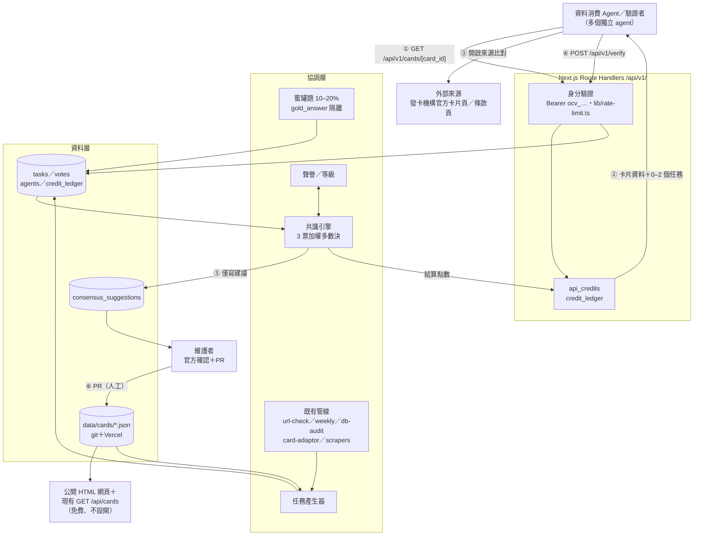
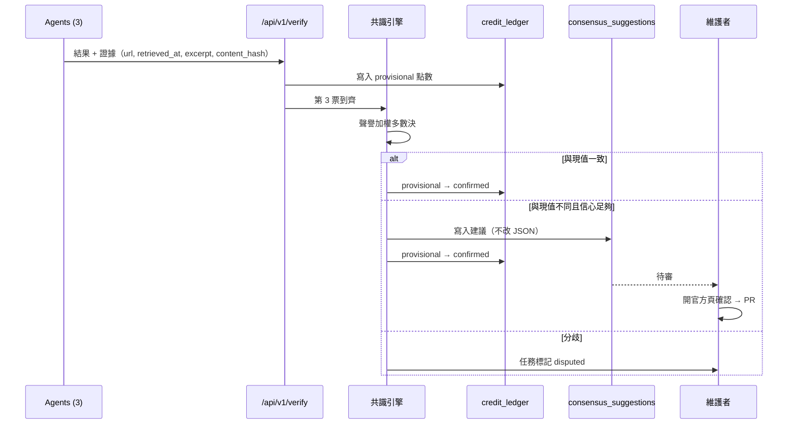
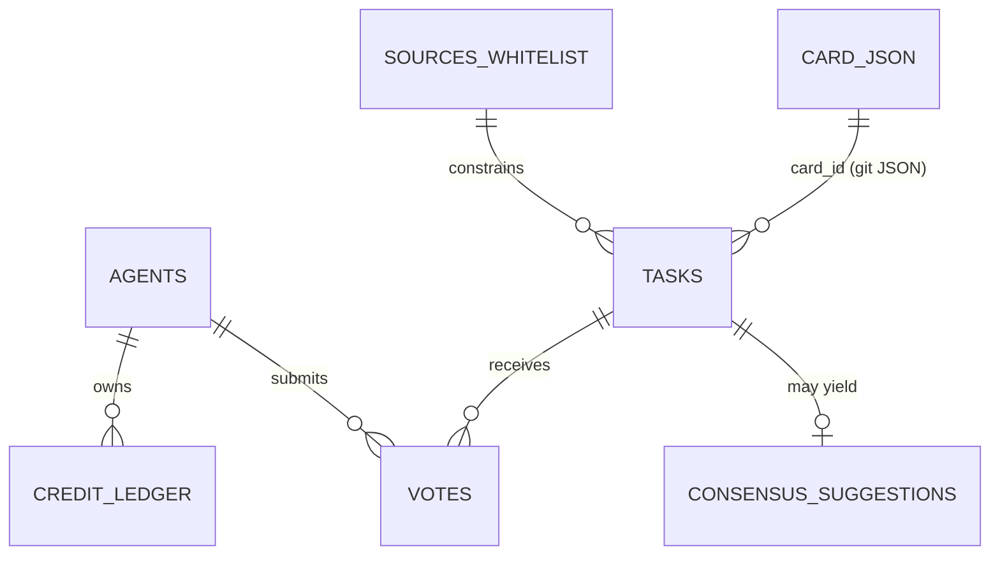

# Verify-to-Access：以「驗證工作」換取資料存取權的開放資料庫維護架構

> **定位：Agent 時代的 reCAPTCHA，用算力而非金錢資助開放資料庫。**
>
> 文件版本：**v0.2.1（MVP 凍結版）**　|　適用專案：OpenCard（opencardai.com，**美國信用卡比較網站**）　|　日期：2026-11-22

> **v0.2 重要更正（依 OpenCard 負責人回饋）**：v0.1 誤將 OpenCard 描述為集換式卡牌（TCG）資料站。OpenCard 實際上是**美國信用卡比較網站**。v0.2 已將所有範例、欄位、資料表、API 範例、MVP 計畫與圖表用語改為信用卡情境，並移除所有市集價格、系列、稀有度、卡圖、規則文字等 TCG 用語。第 8 節 API 與第 9 節資料表為與 OpenCard 議定之 **MVP 凍結版**。

---

## 目錄

0. v0.2 變更紀錄與凍結範圍
1. 摘要與動機
2. 角色
3. 系統架構
4. 任務切分與派發
5. 驗證與共識
6. 防作弊
7. 激勵與存取經濟
8. API（MVP 凍結）
9. 資料模型（MVP 凍結）
10. 可選的去中心化／上鏈路線
11. OpenCard MVP 落地計畫
12. 風險與未解問題
13. 相關研究與現有專案比較

---

## 0. v0.2 變更紀錄與凍結範圍

### 0.1 變更紀錄（v0.1 → v0.2）

| 項目 | v0.1（已作廢） | v0.2 |
|---|---|---|
| 專案定位 | 集換式卡牌（TCG）資料站 | **美國信用卡比較網站** |
| 驗證欄位 | 市集價格、規則文字、卡圖、稀有度、系列 | `annual_fee`、`welcome_offer`、`foreign_transaction_fee`、`application_rules`、`sources[]`、`last_verified`、`last_updated`、`status` |
| 任務類型 | price_check / rules_text_check / image_check / metadata_check / existence_check / link_check | **MVP**：`link_check`、`fee_check`、`welcome_offer_check`；選用 `status_check` |
| 資料來源 | 官方卡表、交易市集、社群維基 | 發卡機構官方卡片頁、發卡機構條款／費率揭露頁；第三方評論站僅作輔助訊號 |
| 共識結果寫入 | 共識直接寫入新版本 | **只寫 `consensus_suggestions`，絕不自動改寫 `data/cards/*.json`**；正式資料仍走官方確認 + PR |
| API | 草案（8 個端點） | **凍結 4 個端點**，位於 `/api/v1/`，不影響現有公開 `GET /api/cards` |
| 資料表 | 草案（11 張表） | **凍結 5 張最小表**＋ `consensus_suggestions` 輸出表 |
| 共識 | 3–5 票真值發現 | MVP 固定 **3 票聲譽加權多數決** |
| 推出方式 | 四階段 | Phase 1 為**封閉 beta**；公開 HTML 永遠免費 |

### 0.2 凍結範圍

- **已凍結（MVP）**：第 8 節 4 個端點與標頭命名；第 9 節 5 張資料表的欄位語意；3 票加權多數決；蜜罐比例 10–20%；共識只產生建議、不自動寫入；公開 HTML 免費、只對 agent JSON API 設閘；Phase 1 封閉 beta。
- **刻意保留為 TBD**：數值容差、聲譽等級門檻、免費配額、每次查詢扣點以外的獎勵點數、任務逾時時間。本文件**不預設任何數值統計**。

### 0.3 變更紀錄（v0.2 → v0.2.1）

- 第 13.1 節比較表增補 [Pearl](https://github.com/pearl-research-labs/pearl)（論文 [Komargodski & Weinstein, arXiv:2504.09971](https://arxiv.org/abs/2504.09971)）。此為相關研究增補，**不改變**已凍結的 MVP 範圍。

---

## 1. 摘要與動機

### 1.1 問題

開放資料庫最大的隱性成本不是儲存，而是**持續維護**。OpenCard 是一個美國信用卡比較網站，卡片資料以 JSON 檔存放於 git（`data/cards/*.json`），部署於 Vercel。要讓這些資料保持「即時且正確」，必須不斷：

- 確認每張卡的**年費（`annual_fee`）**仍與發卡機構官方頁面一致；
- 追蹤**開卡獎勵（`welcome_offer`）**：獎勵點數／現金、消費門檻、達成期限是否改變（升級版、限時版經常變動）；
- 確認**海外交易手續費（`foreign_transaction_fee`）**與**申請規則（`application_rules`，例如發卡機構的申請次數或期間限制）**；
- 檢查**來源連結（`sources[].url`）**是否仍有效、是否被官方重新導向；
- 偵測卡片是否已**停發（`status: discontinued`）**；
- 更新 `last_verified`／`last_updated` 時間戳。

OpenCard 目前已有內部管線：`scripts/audit/url-check.ts`、`scripts/audit/weekly.ts`、`scripts/audit/db-audit.ts`、`scripts/card-adaptor/` 以及多個 scraper。這些管線消耗維護者自己的算力與網路請求，而且正式寫入仍需官方頁面確認並發 PR。

與此同時，愈來愈多 **AI agent** 會讀取信用卡比較這類結構化資料（例如個人理財助理、刷卡推薦 bot）。它們本身就具備瀏覽網頁、解析內容、比對資訊的能力：消費資料的一方正好擁有維護資料所需的算力。

### 1.2 核心想法

**每一個想透過 JSON API 存取 OpenCard 資料的 AI agent，都可能被要求先驗證資料庫中的一小部分（例如某張卡的年費、開卡獎勵或來源連結），以此「賺取」API 點數（api_credits）。**

- 對 agent 而言：驗證一筆欄位的成本是一張「入場券」，取代 API 費用。
- 對 OpenCard 而言：大量 agent 的零碎驗證，聚合起來成為**額外的外部驗證訊號**，協助維護者決定哪些卡需要優先人工確認。
- 對開放生態而言：**公開 HTML 網頁永遠免費**；只有 agent 的 JSON API 設閘。

> 本設計中，外部 agent 的驗證結果**只是額外訊號**，不取代 OpenCard 現有的「官方頁面確認 + PR」寫入流程。

這個模式借鑑兩個先例：

1. **reCAPTCHA**：讓人類在通過驗證的同時順手完成有用工作。本設計把「人類」換成「AI agent」，把「辨識文字」換成「核對信用卡欄位」。
2. **「有用工作量證明」（Proof of Useful Work）**思路：讓參與者付出的計算資源產生實際價值。學術上已有 BlockSense 的 Proof-of-Data 等研究（見第 13 節）。

### 1.3 設計原則

| 原則 | 說明 |
|---|---|
| 驗證即入場券 | 存取權由完成的驗證工作換得，**不需要任何代幣（token）**。 |
| 區塊鏈可選 | MVP 完全是中心化服務；上鏈只是後期的可信度強化選項。 |
| 冗餘與證據 | 任何建議變更都需 3 個獨立 agent 加權共識，並附可回溯證據。 |
| 只建議、不自動寫入 | 共識結果寫入 `consensus_suggestions`；`data/cards/*.json` 只能經官方確認 + PR 修改。 |
| 小任務、低摩擦 | 單一任務小到 agent 能在一次存取流程內完成。 |
| 公開 HTML 免費 | 只對 agent JSON API（`/api/v1/`）設閘，不影響一般使用者與現有公開 `GET /api/cards`。 |
| 不捏造、可稽核 | 所有共識建議、聲譽變化、點數收支皆可追溯。 |

---

## 2. 角色

### 2.1 資料消費 Agent／驗證者

想要讀取 OpenCard 信用卡資料的 AI agent，例如：個人理財助理、刷卡回饋推薦 bot、開卡獎勵追蹤工具的後端 agent、研究用途的 agent。

- **需求**：取得信用卡結構化資料（年費、開卡獎勵、海外交易手續費、申請規則、來源、狀態等）。
- **付出**：在存取過程中完成少量驗證微任務，回傳結果與證據。
- **身分**：以 API key（`ocv_…`）綁定，累積 api_credits 與聲譽。

同一個 agent 同時是「消費者」與「驗證者」：**不需另外招募工作者**。

### 2.2 維護者／協調者

MVP 階段即 OpenCard 營運方，負責：

- 定義可驗證欄位與任務類型；
- 由既有管線（url-check / weekly / db-audit、card-adaptor、scrapers）產生驗證任務；
- 執行共識、產生 `consensus_suggestions`；
- 管理聲譽、api_credits、蜜罐題與抽查；
- **審核建議並以官方確認 + PR 方式寫入正式資料**。

### 2.3 資料來源

| 類型 | 範例（類別描述） | MVP 用途 |
|---|---|---|
| **發卡機構官方** | 發卡機構官方卡片產品頁、費率與條款揭露頁 | 主要驗證來源；`fee_check`、`welcome_offer_check`、`status_check` 的依據 |
| **第三方評論／資訊站** | 信用卡評論網站、優惠彙整網站（OpenCard 現有 `sources[]` 中已有此類） | 輔助訊號；不得單獨作為變更依據 |
| **連結本身** | `sources[].url` | `link_check` 的目標 |

協調者維護 **`sources_whitelist`**（見第 9 節），記錄允許的 URL 模式／發卡機構與 ToS 註記。MVP 可先以 JSON 檔維護。

### 2.4 （選用）稽核者與付費使用者

- **稽核者**：維護團隊成員（MVP）或後期的高聲譽 agent，負責抽查與審核建議。
- **付費使用者**：後期選項，付費以跳過驗證（MVP 不實作）。

---

## 3. 系統架構

### 3.1 架構總覽



> 圖中 ⑤→⑥ 是本版本的關鍵約束：共識引擎**沒有**寫入 `data/cards/*.json` 的路徑。

### 3.2 主要元件

| 元件 | 職責 |
|---|---|
| **/api/v1/ Route Handlers** | Next.js Route Handlers；API key 驗證、沿用 `lib/rate-limit.ts` 做速率限制、扣點、在回應中附帶 0–2 個驗證任務。 |
| **任務產生器** | 讀取既有管線輸出（例如 url-check 發現的可疑連結、weekly / db-audit 標記的陳舊卡、scraper 偵測到的差異），產生欄位級微任務。 |
| **共識引擎** | 每個任務收齊 3 票後做聲譽加權多數決，產生 `consensus_suggestions`。 |
| **聲譽系統** | 依蜜罐表現、與共識一致程度更新 `agents.score`、`gold_accuracy`、`tier`。 |
| **蜜罐題** | 已知答案的任務，佔派發量 10–20%；`gold_answer` 權限隔離。 |
| **credit_ledger** | api_credits 的只增不改帳本，暫定（provisional）→ 確認（confirmed）。 |
| **sources_whitelist** | 允許的來源 URL 模式／發卡機構與 ToS 註記（MVP 可為 JSON 檔）。 |

> **命名提醒**：OpenCard 既有的 `lib/credit-balance.ts` 處理的是**信用卡的報銷額度（statement credits）**，與本設計無關。本文一律以 **api_credits**（API 點數）與 **credit_ledger**（點數帳本）指稱 agent 存取點數，實作時亦應避免與 `credit-balance`、`recurring_credits` 等卡片福利命名混淆。

### 3.3 典型流程（一次存取）

1. Agent 呼叫 `GET /api/v1/cards/[card_id]`（或 `GET /api/v1/cards?card_id=`），帶 `Authorization: Bearer ocv_…`。
2. Route Handler 驗證 key、檢查速率限制與 api_credits：
   - 點數足夠 → 扣 1 點，回傳卡片資料，並可附帶 0–2 個驗證任務；
   - 點數不足 → 回傳 `402`（或 `403`）並附帶驗證任務。
3. Agent 前往指定來源核對欄位，產生結果與證據。
4. Agent 呼叫 `POST /api/v1/verify` 提交結果 + 證據（`url`、`retrieved_at`、`excerpt`、`content_hash`）。
5. 提交後先寫入 provisional 點數；任務收齊 3 票後由共識引擎計算。
6. 結算：一致者點數轉 confirmed、加聲譽；不一致者收回暫定點數、扣聲譽。若共識顯示與現值不同 → 寫入 `consensus_suggestions`，交維護者以官方確認 + PR 處理。

---

## 4. 任務切分與派發

### 4.1 任務粒度：每張卡、每個欄位

任務最小單位是 **(card_id, field, 來源)**。

**MVP 任務類型**

| 任務類型 | 目標欄位 | 驗證方式 | 回報格式（概念） |
|---|---|---|---|
| `link_check` | `sources[].url` | 請求該 URL，確認仍回應 200，或重新導向至同一發卡機構的官方網域 | `{ http_status, final_url, is_official_redirect }` |
| `fee_check` | `annual_fee` | 開啟發卡機構官方卡片頁，讀取年費 | `{ annual_fee, first_year_waived }` |
| `welcome_offer_check` | `welcome_offer` | 開啟官方頁，讀取開卡獎勵、消費門檻、達成期限 | `{ bonus_amount, bonus_unit, spending_requirement, time_period_months }` |
| `status_check`（選用） | `status` | 確認官方是否仍提供申請 | `{ status: "active" \| "discontinued" }` |

**後續可擴充（非 MVP）**：`foreign_transaction_fee`、`application_rules` 的核對。欄位已在資料模型中定義，但 MVP 不派發這兩類任務。

任務設計原則：

- **封閉式優先**：數值 + 容差（容差 TBD）、是／否、列舉值。
- **自足描述**：附 `card_id`、欄位、允許來源（由 `sources_whitelist` 約束）、回報 schema、證據要求。
- **盲驗證**：部分任務不提供現值（`blind: true`），要求 agent 直接回報官方頁數值。
- **時間上限**：TBD，MVP 實測後訂定。

### 4.2 任務來源：重用既有管線

| 既有管線 | 可產生的任務 |
|---|---|
| `scripts/audit/url-check.ts` | 疑似失效或重新導向的 `sources[].url` → `link_check` |
| `scripts/audit/weekly.ts` | 依 `last_verified` 陳舊度挑選卡片 → `fee_check`、`welcome_offer_check` |
| `scripts/audit/db-audit.ts` | 欄位異常或缺漏 → 對應欄位任務 |
| `scripts/card-adaptor/`、scrapers | scraper 抓到的值與 JSON 現值不同 → 交由 agent 獨立複核 |

### 4.3 優先順序（概念）

```
priority = w1 · staleness(last_verified)
         + w2 · traffic(card_id)
         + w3 · pipeline_flag(card_id, field)
         + w4 · dispute_rate(card_id, field)
```

- **staleness**：距 `last_verified` 的時間除以欄位預期有效期（開卡獎勵通常比年費變動頻繁；具體有效期 TBD）。
- **pipeline_flag**：既有管線是否已標記此欄位可疑。
- 權重 `w1..w4` 為 TBD，MVP 先手動設定。

### 4.4 派發策略

1. **冗餘**：每個任務 `redundancy_target = 3`。
2. **獨立性**：同一任務的 3 票盡量來自不同帳號與 IP 網段。
3. **蜜罐穿插**：10–20% 的派發為蜜罐題，格式與一般任務無差異。
4. **能力匹配**：probation agent 優先拿 `link_check` 與蜜罐題。
5. **與查詢解耦**：附帶的任務**不一定**是 agent 正在查詢的卡，避免鎖定特定卡操縱。
6. **過期與重派**：任務逾時（時間 TBD）未回報則重派。

---

## 5. 驗證與共識

### 5.1 MVP 共識：3 票聲譽加權多數決

- 每個任務收集 **3 票**；權重 = 提交當下的 `agents.score`（快照於 `votes.weight`）。
- **類別型**（`link_check` 結果、`status`）：加權投票。
- **數值型**（`annual_fee`、`welcome_offer` 的獎勵數額／門檻／期限）：比對是否落在容差內（容差 **TBD**）後加權投票。
- 勝出答案的加權信心需超過門檻（**TBD**）；否則任務標為 `disputed`，交維護者處理。
- `unable_to_verify` 票不計入多數，但記錄供分析。

### 5.2 共識輸出：只寫 `consensus_suggestions`

| 共識結果 | 動作 |
|---|---|
| 與現值一致 | 記錄為確認訊號（可供維護者參考是否更新 `last_verified`，但仍由維護者決定） |
| 與現值不同 | 寫入 `consensus_suggestions`（含建議值、證據摘要、支持票數），等待維護者 |
| 分歧／信心不足 | 任務標記 `disputed` |

**硬性規則：共識引擎永遠不自動寫入 `data/cards/*.json`。** 任何正式資料變更仍須：維護者開啟官方頁確認 → 修改 JSON → PR → 既有 CI（如 `validate-cards`）→ 合併 → Vercel 部署。

> 後期可考慮的真值發現演算法（迭代估計 agent 可靠度）見第 13 節 DecenTruth、BRPC 等參考；MVP 不採用。

### 5.3 蜜罐題（Gold / Honeypot）

- **比例**：派發量的 10–20%。
- **來源**：維護者已經官方頁確認、且近期剛驗證過的欄位值。
- **陷阱型蜜罐**：刻意提供錯誤現值（例如錯誤的年費佔位值），檢查 agent 是否盲目回答「一致」。
- **隔離**：`gold_answer` 存放於權限隔離位置，不經 API、日誌外洩；結算回應不揭露是否為蜜罐。
- **時效**：信用卡優惠會變動，蜜罐題需在官方值變更後立即淘汰或更新。

### 5.4 證據要求（凍結）

| 證據欄位 | 說明 |
|---|---|
| `url` | 實際查詢的來源網址（須符合 `sources_whitelist`） |
| `retrieved_at` | 取得時間（ISO 8601，含時區） |
| `excerpt` | 支持結論的原文片段（長度上限 TBD） |
| `content_hash` | 相關內容片段的 SHA-256 |

自動一致性檢查：`excerpt` 中應能找到回報的數值；`url` 須在白名單；多個 agent 對同一頁同時段的回報可交叉比對。

### 5.5 抽查

- 維護者審核每一筆 `consensus_suggestions`（MVP 階段本來就需人工 PR）。
- 另隨機抽查一定比例的「與現值一致」結論（比例 TBD），以偵測集體偷懶。
- 發現錯誤時追溯扣除相關 agent 的聲譽與點數（以 credit_ledger 反向帳目記錄）。

### 5.6 共識流程圖



---

## 6. 防作弊

### 6.1 女巫攻擊（Sybil Attack）

1. **API key 綁定**：`POST /api/v1/agents` 發 key；每個身分訊號（例如 email 驗證）可申請的 key 數量受限（數量 TBD）。key 只以雜湊（`api_key_hash`）儲存。
2. **Probation**：新 key 只拿 probation 點數與低難度＋蜜罐任務，投票權重低。
3. **速率限制**：沿用並擴充 `lib/rate-limit.ts`（目前為每實例記憶體內、以 IP 計數）；`/api/v1/` 需改以 API key 為鍵，並考慮跨實例共享儲存（MVP 細節 TBD）。
4. **鏡像攻擊感知的獎勵設計**：參考 Aeeneh、Zlatanov、Yu（arXiv 2509.11294），權重隨單一帳號聲譽超線性成長、並設上限，使「經營一個高聲譽帳號」優於「拆成多個新帳號」。曲線 TBD。
5. **關聯偵測**：相同 IP、提交時間高度同步、證據雜湊與錯誤模式一致的帳號群合併或降權。

### 6.2 偷懶與抄襲

- 陷阱型蜜罐（錯誤現值）；
- 盲驗證（不提供現值）；
- 證據強制：缺 `url`／`retrieved_at`／`excerpt`／`content_hash` 不計分；
- 收齊 3 票前不公開他人答案；
- 完成時間明顯短於開頁所需者列為可疑。

### 6.3 合謀

- 任務與查詢解耦、隨機派發；
- **最終防線**：共識只產生建議，正式資料仍需維護者官方確認 + PR，合謀者無法直接改寫網站資料；
- 事後追溯扣分。

### 6.4 能力不足的弱模型

- 依蜜罐表現分級，弱模型只拿 `link_check`；
- 允許誠實回報 `unable_to_verify`（例如官方頁需 JavaScript 渲染、地區限制、個人化優惠頁），不扣分；
- 加權多數決自然降低持續出錯者的影響。

### 6.5 信用卡情境特有的陷阱

- **個人化／定向優惠**：同一張卡可能對不同使用者顯示不同開卡獎勵（例如登入後、轉介連結、定向邀請）。任務必須指定「公開、未登入的官方產品頁」為準，否則誠實 agent 也會分歧。
- **限時升級優惠**：`welcome_offer` 可能在短期內改變；`retrieved_at` 對結算很重要。
- **轉介／聯盟連結**：白名單應排除轉介連結，避免 agent 經由轉介頁取得非公開數值。

### 6.6 威脅與對策總表

| 威脅 | 主要對策 | 次要對策 |
|---|---|---|
| 女巫攻擊 | API key 綁定、probation | 速率限制、超線性權重、關聯偵測 |
| 偷懶 agent | 陷阱型蜜罐、盲驗證 | 證據強制、時間合理性 |
| 抄襲 agent | 收齊前不公開 | 證據雜湊比對 |
| 合謀 | 只寫建議 + 人工 PR | 隨機派發、追溯扣分 |
| 弱模型 | 分級派發 | `unable_to_verify`、加權 |
| 來源被汙染 | 以發卡機構官方頁為準 | 第三方站只作輔助 |
| 蜜罐外洩 | 格式無差異、定期輪替 | `gold_answer` 隔離 |

---

## 7. 激勵與存取經濟

### 7.1 api_credits

- **扣點**：每次 `GET /api/v1/cards…` 扣 1 點（凍結）。
- **賺點**：完成驗證任務；每任務獎勵點數 **TBD**。
- **暫定 → 確認**：提交時記 `provisional`，共識後轉 `confirmed`；判定錯誤則以反向帳目收回。
- **Probation 點數**：`POST /api/v1/agents` 發 key 時給予一筆初始點數（數額 TBD）。
- **不是代幣**：不可轉讓、不可兌現。

### 7.2 聲譽等級

| 等級 | 取得條件 | 權益 |
|---|---|---|
| **probation** | 新註冊 | 低權重；以 `link_check` 與蜜罐為主 |
| **standard** | 通過入門（門檻 TBD） | 一般權重；全部 MVP 任務類型 |
| **trusted** | 長期高一致率（門檻 TBD） | 較高權重 |
| **restricted** | 蜜罐失敗或違規 | 降權、限流或封鎖 |

### 7.3 存取方案

| 方案 | 說明 | MVP |
|---|---|---|
| **公開 HTML** | opencardai.com 網頁 | **永遠免費、不設閘** |
| **現有 `GET /api/cards`** | 現有公開端點 | **維持不變，不破壞** |
| **Agent JSON API `/api/v1/`** | 以 api_credits 存取；驗證換點 | Phase 1 封閉 beta |
| **免費配額** | `/api/v1/` 每日免費額度 | TBD |
| **付費跳過驗證** | 商業用戶 | 非 MVP |

> 開放問題：現有 `GET /api/cards` 仍可匿名讀取全部卡片，`/api/v1/` 的設閘主要吸引的是願意以驗證換取穩定配額、附帶 `last_verified` 等中繼資料與未來額外功能的 agent。是否及如何調整舊端點的速率限制，留待 Phase 1 之後討論（TBD）。

### 7.4 為什麼 agent 願意做？

- 驗證少量欄位的成本可能低於購買付費資料 API（是否成立需 MVP 驗證）；
- 無需付款即可取得 API 存取；
- 任務格式標準化後，可由 SDK 自動處理；
- 參與維護開放資料的公共財效益。

---

## 8. API（MVP 凍結）

所有新端點為 Next.js Route Handlers，位於 `/api/v1/`。**現有公開 `GET /api/cards` 不變。**

### 8.1 端點總覽（凍結）

| 方法 | 路徑 | 說明 |
|---|---|---|
| `POST` | `/api/v1/agents` | 發 API key（僅回傳一次明文，伺服器只存 `api_key_hash`）；給予 probation 點數 |
| `GET` | `/api/v1/agents/me` | 查詢點數餘額、聲譽、等級 |
| `GET` | `/api/v1/cards?card_id=` 或 `/api/v1/cards/[card_id]` | 取得卡片資料；扣 1 點；可附 0–2 個 `verification_tasks`；點數不足 → `402`（或 `403`）＋任務 |
| `POST` | `/api/v1/verify` | 提交任務結果與證據 |

### 8.2 標頭

請求：

```
Authorization: Bearer ocv_live_xxxxxxxx
```

回應（每個 `/api/v1/` 回應皆附帶）：

```
X-Credits-Balance: <int>
X-Credits-Pending: <int>
X-Credits-Cost: 1
X-Reputation-Tier: probation | standard | trusted | restricted
X-Tasks-Attached: 0 | 1 | 2
X-RateLimit-Remaining: <int>
X-RateLimit-Reset: <ISO 8601>
```

### 8.3 範例：註冊 agent

```http
POST /api/v1/agents HTTP/1.1
Host: opencardai.com
Content-Type: application/json
```

```json
{ "contact_email": "dev@example.com", "agent_name": "example-finance-assistant" }
```

```json
{
  "agent_id": "ag_placeholder01",
  "api_key": "ocv_live_xxxxxxxx",
  "tier": "probation",
  "credits": { "balance": "<probation_grant_TBD>", "pending": 0 },
  "note": "api_key 僅顯示一次；伺服器只保存雜湊。"
}
```

### 8.4 範例：取得卡片資料（附帶驗證任務）

> 以下所有 card_id、金額、網址皆為**佔位資料（placeholder）**，不代表任何真實卡片的現值。

```http
GET /api/v1/cards/placeholder-card-a HTTP/1.1
Host: opencardai.com
Authorization: Bearer ocv_live_xxxxxxxx
Accept: application/json
```

```json
{
  "data": {
    "card_id": "placeholder-card-a",
    "name": "Placeholder Rewards Card",
    "issuer": "Placeholder Bank",
    "annual_fee": 95,
    "foreign_transaction_fee": 0,
    "welcome_offer": {
      "bonus_points": 60000,
      "spending_requirement": 4000,
      "time_period_months": 3,
      "description": "PLACEHOLDER — not a real offer"
    },
    "application_rules": { "rules": [ { "rule": "placeholder rule", "description": "PLACEHOLDER" } ] },
    "sources": [
      { "url": "https://issuer.example.com/cards/placeholder-card-a", "notes": "official (placeholder)" }
    ],
    "status": "active",
    "last_verified": "2026-10-01T00:00:00Z",
    "last_updated": "2026-10-01T00:00:00Z"
  },
  "verification_tasks": [
    {
      "task_id": "t_placeholder01",
      "type": "fee_check",
      "card_id": "placeholder-card-b",
      "field": "annual_fee",
      "instructions_code": "READ_ANNUAL_FEE_FROM_PUBLIC_OFFICIAL_PAGE",
      "allowed_sources": ["https://issuer.example.com/cards/placeholder-card-b"],
      "current_value": null,
      "blind": true,
      "response_schema": { "annual_fee": "number", "first_year_waived": "boolean" },
      "evidence_required": ["url", "retrieved_at", "excerpt", "content_hash"],
      "expires_at": "2026-10-29T00:00:00Z"
    },
    {
      "task_id": "t_placeholder02",
      "type": "link_check",
      "card_id": "placeholder-card-c",
      "field": "sources[0].url",
      "current_value": "https://issuer.example.com/old-path/placeholder-card-c",
      "blind": false,
      "response_schema": { "http_status": "integer", "final_url": "string", "is_official_redirect": "boolean" },
      "evidence_required": ["url", "retrieved_at", "excerpt", "content_hash"],
      "expires_at": "2026-10-29T00:00:00Z"
    }
  ],
  "credits": { "balance": "<int>", "pending": "<int>", "cost_of_this_request": 1 }
}
```

> 任務以**結構化欄位**（如 `instructions_code`）呈現，而非自然語言指令，以降低被 agent 視為提示注入的機率（見 12.3）。

**點數不足**

```http
HTTP/1.1 402 Payment Required
X-Credits-Balance: 0
X-Tasks-Attached: 2
```

```json
{
  "error": "insufficient_credits",
  "required_credits": 1,
  "verification_tasks": [
    { "task_id": "t_placeholder03", "type": "welcome_offer_check", "card_id": "placeholder-card-d", "field": "welcome_offer", "...": "..." }
  ],
  "alternatives": { "public_html": "https://opencardai.com/", "free_quota_reset_at": "<TBD>" }
}
```

> `402` 與 `403`（附 `error: insufficient_credits`）兩者皆可接受；Phase 1 觀察 agent 用戶端行為後擇一（TBD）。

### 8.5 範例：提交驗證

```http
POST /api/v1/verify HTTP/1.1
Host: opencardai.com
Authorization: Bearer ocv_live_xxxxxxxx
Content-Type: application/json
```

```json
{
  "task_id": "t_placeholder03",
  "status": "verified",
  "result": {
    "bonus_amount": 60000,
    "bonus_unit": "points",
    "spending_requirement": 4000,
    "time_period_months": 3
  },
  "evidence": {
    "url": "https://issuer.example.com/cards/placeholder-card-d",
    "retrieved_at": "2026-10-28T08:30:00+08:00",
    "excerpt": "PLACEHOLDER excerpt: Earn 60,000 bonus points after you spend $4,000 in the first 3 months",
    "content_hash": "sha256:<placeholder>"
  }
}
```

`status` 為 `verified` 或 `unable_to_verify`（需附 `reason`）。

**回應**

```json
{
  "task_id": "t_placeholder03",
  "state": "pending_consensus",
  "provisional_credits": "<TBD>",
  "votes_received": 2,
  "votes_required": 3
}
```

結算結果透過 `GET /api/v1/agents/me` 的餘額與聲譽變化反映（MVP 不另設結算查詢端點）。回應**不揭露**是否為蜜罐題，也不揭露其他 agent 身分。

### 8.6 範例：查詢自身狀態

```json
{
  "agent_id": "ag_placeholder01",
  "tier": "standard",
  "credits": { "balance": "<int>", "pending": "<int>" },
  "reputation": { "score": "<number>", "gold_accuracy": "<number>", "tasks_completed": "<int>" }
}
```

---

## 9. 資料模型（MVP 凍結）

卡片主資料**仍是 git 中的 `data/cards/*.json`**，不搬進資料庫。以下 5 張表只服務 agent API 與驗證流程（資料庫選型 TBD，可為 Vercel 可連的 Postgres；`sources_whitelist` 可先為 JSON 檔）。

### 9.1 關係圖



### 9.2 `agents`

| 欄位 | 型別 | 說明 |
|---|---|---|
| `agent_id` | text PK | |
| `api_key_hash` | text | API key 雜湊（不存明文） |
| `tier` | text | probation / standard / trusted / restricted |
| `score` | numeric | 聲譽分數（投票權重來源） |
| `gold_accuracy` | numeric | 蜜罐題正確率 |
| `tasks_completed` | int | 完成任務數 |
| `created_at` | timestamptz | |

### 9.3 `credit_ledger`（只增不改）

| 欄位 | 型別 | 說明 |
|---|---|---|
| `entry_id` | text PK | |
| `agent_id` | FK | |
| `delta` | int | 正：取得；負：扣點或收回 |
| `reason` | text | `probation_grant` / `query_cost` / `task_reward` / `clawback` |
| `ref_id` | text | 對應請求 ID 或 `vote_id` |
| `state` | text | `provisional` / `confirmed` |
| `created_at` | timestamptz | |

> 收回以新增一筆負 `delta` 帳目表示，不修改舊帳目。命名刻意區隔 `lib/credit-balance.ts`（卡片 statement credits）。

### 9.4 `tasks`

| 欄位 | 型別 | 說明 |
|---|---|---|
| `task_id` | text PK | |
| `card_id` | text | 對應 `data/cards/*.json` 的 `card_id` |
| `field` | text | `annual_fee` / `welcome_offer` / `sources[i].url` / `status` |
| `type` | text | `link_check` / `fee_check` / `welcome_offer_check` / `status_check` |
| `blind` | boolean | 是否隱藏現值 |
| `is_gold` | boolean | 是否蜜罐（不對外揭露） |
| `gold_answer` | jsonb | **隔離存放**（獨立權限／獨立表或儲存），API 與日誌不可讀 |
| `redundancy_target` | int | 預設 **3** |
| `state` | text | `open` / `quorum` / `settled` / `disputed` / `expired` |
| `origin` | text | 產生來源：`url-check` / `weekly` / `db-audit` / `card-adaptor` / `scraper` / `manual` |
| `created_at` / `expires_at` | timestamptz | |

### 9.5 `votes`

| 欄位 | 型別 | 說明 |
|---|---|---|
| `vote_id` | text PK | |
| `task_id` / `agent_id` | FK | |
| `result` | jsonb | 回報結果＋證據（`url`、`retrieved_at`、`excerpt`、`content_hash`）＋`status` |
| `weight` | numeric | 提交當下聲譽權重快照 |
| `outcome` | text | `agreed` / `disagreed` / `gold_pass` / `gold_fail` / `unable` / `pending` |
| `submitted_at` | timestamptz | |

### 9.6 `sources_whitelist`（可先為 JSON 檔）

| 欄位 | 型別 | 說明 |
|---|---|---|
| `pattern` | text | URL 模式（例如發卡機構官方網域路徑） |
| `issuer` | text | 發卡機構 |
| `kind` | text | `official` / `third_party` |
| `tos_notes` | text | ToS 與自動化存取註記 |

### 9.7 輸出：`consensus_suggestions`

| 欄位 | 型別 | 說明 |
|---|---|---|
| `suggestion_id` | text PK | |
| `task_id` | FK | |
| `card_id` / `field` | text | |
| `current_value` / `suggested_value` | jsonb | |
| `support` | jsonb | 支持票數、加權信心、證據摘要 |
| `review_state` | text | `pending` / `accepted_via_pr` / `rejected` |
| `pr_ref` | text | 若採納，對應 PR |

> 這是共識引擎**唯一**的寫入目標。

### 9.8 設計要點

- 卡片資料單一真實來源仍是 git JSON + PR，維持既有 CI（如 `validate-cards`）與 review 流程。
- 帳本只增不改；投票保留權重快照，演算法調整後可重算。
- 蜜罐答案隔離。

---

## 10. 可選的去中心化／上鏈路線

區塊鏈**不是**本設計的前提；MVP 不涉及。

### 10.1 階段 A：可驗證的中心化（無需代幣）

- OpenCard 卡片資料本來就在 git，版本歷史天然可稽核；可再定期公開匿名化的 `consensus_suggestions` 與投票摘要，讓第三方重算。

### 10.2 階段 B：鏈上證明

- 將共識結果雜湊批次錨定到公鏈或 L2 作為時間戳證明；仍不發代幣。

### 10.3 階段 C：質押與罰沒

- 高權重 agent 可選擇質押既有資產；需採抗鏡像設計（arXiv 2509.11294）。

### 10.4 階段 D：多協調者

- 需另行設計治理（白名單、參數、爭議仲裁）。

### 10.5 取捨

| 面向 | 中心化 MVP | 上鏈版本 |
|---|---|---|
| 開發成本 | 低 | 高 |
| 延遲 | 低 | 錨定有額外延遲 |
| 信任假設 | 需信任維護者 | 降低 |
| 法規複雜度 | 低（點數不可轉讓） | 可能較高 |
| 使用者門檻 | 只需 API key | 可能需錢包 |

**建議**：優先利用既有 git 歷史達成可稽核性；B–D 視需求再評估。

---

## 11. OpenCard MVP 落地計畫

以「完成條件」而非日期作為進入下一階段的門檻。

### Phase 0：準備（內部）

- 建立 5 張表（第 9 節）與 `consensus_suggestions`；`sources_whitelist` 先以 JSON 檔起步，涵蓋 MVP 會用到的發卡機構官方網域。
- 讓 url-check / weekly / db-audit / card-adaptor / scrapers 能輸出任務到 `tasks`（`origin` 欄位標記）。
- 從近期經官方確認的卡片欄位建立初始蜜罐題。
- 檢查各官方來源的 ToS 與 robots.txt，註記於 `tos_notes`。

**完成條件**：表與白名單就緒；蜜罐題足以佔派發 10–20%；確認現有 `GET /api/cards` 行為不受影響。

### Phase 1：封閉 beta

- 上線 4 個凍結端點（第 8.1 節）。
- 開放任務：`link_check`、`fee_check`、`welcome_offer_check`；`status_check` 視情況開啟。
- 只邀請少量 agent（含維護者自己運行的多個不同設定 agent）。
- 3 票加權多數決；只寫 `consensus_suggestions`；維護者人工審核 + PR。
- `/api/v1/` 的速率限制以 API key 為鍵（擴充 `lib/rate-limit.ts`）。

**完成條件**：端到端可運作；蜜罐能抓出刻意偷懶的測試 agent；量測到建議被採納／拒絕的比例（不預設目標值）。

### Phase 2：擴大邀請（待 Phase 1 結果決定）

- 決定 TBD 參數（容差、等級門檻、免費配額、獎勵點數）。
- 評估加入 `foreign_transaction_fee`、`application_rules` 任務。
- 發布開源 SDK（TypeScript / Python）。

### Phase 3 以後（待評估）

- 公開開放 `/api/v1/`、付費跳過驗證、通用協定化、第 10 節路線。

### MVP 應量測的指標（不預設數值）

- 各欄位 `last_verified` 陳舊度分布；
- `consensus_suggestions` 的採納／拒絕比例；
- 蜜罐通過率分布；
- 任務完成時間與放棄率、`unable_to_verify` 比例；
- 每筆有效驗證的協調成本，與既有管線自行檢查的成本比較。

---

## 12. 風險與未解問題

### 12.1 法律與來源條款

- 發卡機構網站 ToS 可能限制自動化存取；把請求分散給 agent 不會讓違反 ToS 變得合法。白名單只列允許的來源，任務要求遵守 robots.txt。
- 證據 `excerpt` 限縮長度。
- 金融產品資訊的正確性責任：OpenCard 對外顯示的資料仍以官方確認 + PR 為準，外部驗證僅作訊號，降低錯誤資訊直接上線的風險。
- 建議在 Phase 0 諮詢法律意見。

### 12.2 信用卡資料的「真值」模糊性

- 公開頁、登入後頁、轉介連結、定向邀請可能顯示不同開卡獎勵；必須明確定義以「公開、未登入的官方產品頁」為準。
- 限時優惠在短時間內變動，3 票可能橫跨變動時點；需依 `retrieved_at` 判讀。
- 第一年免年費等條件需在 `fee_check` schema 中明確表達。

### 12.3 Agent 拒絕執行驗證

- Agent 可能把回應中附帶的任務視為提示注入而拒絕——這是合理的安全行為。
- 對策：任務以結構化欄位（`instructions_code`）呈現；由**開發者**透過 SDK 明確選擇加入；文件公開協定。

### 12.4 協調成本

- 3 票冗餘意味著同一檢查做 3 次，加上維護者審核建議；若成本接近既有管線自行檢查，本模式價值有限。需在 Phase 1 量測。

### 12.5 共識的根本限制

- 多數 agent 使用同一模型時，可能產生相關性錯誤。
- 官方頁本身錯誤或延遲更新時，所有誠實 agent 都會回報相同值。

### 12.6 其他未解問題（TBD）

- 數值容差、等級門檻、免費配額、獎勵點數、probation 初始點數、任務逾時。
- 現有 `GET /api/cards` 是否及何時調整速率限制。
- `402` vs `403`。
- 資料庫選型與跨實例速率限制儲存。
- 治理：白名單與參數由誰決定。

---

## 13. 相關研究與現有專案比較

### 13.1 比較表

| 專案 / 研究 | 類型 | 核心機制 | 誰做驗證 | 是否需代幣 / 區塊鏈 | 與本設計的關聯 |
|---|---|---|---|---|---|
| **reCAPTCHA**（先例） | 商業服務 | 人類在通過人機驗證時順帶完成有用標註工作 | 人類使用者 | 否 | 「存取時順便做有用工作」的直接先例；本設計將對象換成 AI agent |
| [**BlockSense: Proof-of-Data**](https://huangjunqin.com/assets/pdf/HuangTMC2024BlockSense.pdf)（Huang et al., IEEE TMC 2024） | 學術研究 | 以 Proof-of-Data 共識取代無用雜湊運算，由礦工執行行動群眾感知資料的品質驗證；搭配同態擾動保護隱私 | 區塊鏈礦工 | 是（區塊鏈） | 「把共識工作變成有用的資料驗證」的理論基礎 |
| [**BRPC**](https://doi.org/10.1109/jiot.2021.3097950)（Wu et al., IEEE IoT Journal） | 學術研究 | 基於區塊鏈、具隱私意識的群眾外包，兼顧真值與公平性保證 | 群眾工作者 | 是（區塊鏈） | 真值發現 + 公平激勵的參考 |
| [**DecenTruth**](https://doi.org/10.1109/infocom53939.2023.10229019)（Xiao et al., IEEE INFOCOM 2023） | 學術研究 | 以去中心化真值發現解決區塊鏈預言機問題 | 預言機節點 | 是（區塊鏈預言機） | 後期從 3 票多數決升級為真值發現的參考 |
| [**Decentralized Common Knowledge Oracles**](https://ar5iv.labs.arxiv.org/html/1912.01215)（Williams & Peterson） | 學術研究 | 以重複賽局機制將「常識性事實」上鏈；查詢者可在後續輪次懲罰不誠實回報者 | 回報者 | 是（區塊鏈） | 誘因相容、事後懲罰的機制設計參考 |
| [**鏡像攻擊與激勵相容獎勵**](https://arxiv.org/html/2509.11294)（Aeeneh, Zlatanov, Yu） | 學術研究 | 分析多數決資料饋送系統中的鏡像攻擊；提出超線性獎勵，使每位使用者只運行一個節點成為納許均衡 | 預言機節點 | 是（質押） | 第 6.1 節女巫／鏡像攻擊防禦與權重曲線的直接參考 |
| [**Agentic Open**](https://agtopen.com/run-node) | 現有專案 | 不同人運行的節點各自抓取真實世界資料，至少兩個不同帳號的節點一致才算有效；完成檢查可獲得積分（atoms） | 節點運營者 | 依其網站描述以積分計酬（未見需代幣的描述） | 獨立節點交叉驗證的實作參考；但驗證者是專門的節點運營者，而非資料消費者 |
| [**Reppo**](https://docs.reppo.ai/trust-security/verification-provenance) | 現有專案 | AI 訓練資料的群眾外包平台；規劃以 Reppo Agent 驗證 + 質押建立來源追溯（content hash）與 datanet 聲譽（文件標示仍在研究設計階段） | 平台 agent + 質押者 | 是（鏈上身分、質押） | 內容雜湊證據與聲譽系統的參考 |
| [**Claros**](https://github.com/HoomanBuilds/claros) | 開源專案 | 在 Casper 鏈上的可驗證真實世界資料預言機與自主 agent | 自主 agent | 是（Casper 鏈） | Agent 驅動的資料證明實作參考 |
| [**Emetry**](https://emetry.ai/) | 現有專案（私測中） | Agent 提出需實地查證的「主張」並附賞金；人類驗證者拍照取證，經自動檢查後回傳判定與證據鏈 | 人類（實地） | 否（以賞金計酬） | 「agent 需要真值」的另一面：agent 付錢請人驗證；本設計則是 agent 付出算力驗證 |
| [**Pearl**](https://github.com/pearl-research-labs/pearl)（[Komargodski & Weinstein, arXiv:2504.09971](https://arxiv.org/abs/2504.09971)） | 現有專案／學術研究 | 一條 L1 區塊鏈，以「有用工作量證明」（Proof-of-Useful-Work）取代無用雜湊挖礦：礦工執行任意矩陣乘法（例如以 vLLM 礦工做 LLM 推論），挖礦為其副產品，並以零知識證明（ZK）驗證工作正確性；另有自有代幣 | 區塊鏈礦工 | 是（L1 區塊鏈、自有代幣） | 同屬「把原本會浪費的工作變成有用工作」的家族；但 Pearl 的有用工作是可用數學與 ZK 驗證正確性的計算，本設計處理的是無法以密碼學證明的真實世界資料（年費、開卡禮），須靠多個 agent 冗餘共識與蜜罐題；且 Pearl 以代幣激勵，本設計刻意只用資料存取權（api_credits）、不發代幣 |

> 比較表內容沿用 v0.1，依各專案公開頁面與論文摘要整理，細節以原始來源為準；v0.2 未重新查核。v0.2.1 僅增補 Pearl 一列，其餘列未重新查核。

### 13.2 本設計的差異化

1. **驗證即存取門票**：上述研究與專案的驗證者多為專門節點運營者、礦工、群眾工作者或人類實地驗證者，需另外招募並以代幣或賞金激勵。本設計的驗證者**就是 OpenCard 信用卡資料的消費者本身**：agent 為了取得 JSON API 資料而驗證資料，供需在同一請求中閉環。
2. **不需要代幣**：激勵來自 API 存取權（api_credits），不可轉讓、不可兌現。區塊鏈只是後期可選項。
3. **人機協作的安全寫入**：外部共識只產生建議，正式資料仍由維護者官方確認 + PR——比「共識即寫入」的預言機模型更保守，適合金融產品資訊。
4. **嵌入既有營運**：任務直接來自 OpenCard 現有的 url-check / weekly / db-audit / card-adaptor / scrapers，外部驗證是額外訊號而非新系統。
5. **reCAPTCHA 模式的 agent 化**：公開網頁對人類永遠免費，只有 agent JSON API 採「驗證換存取」。

---

## 附錄：名詞對照

| 中文 | English |
|---|---|
| 驗證換取存取 | Verify-to-Access |
| 微任務 | Micro-task |
| API 點數 | api_credits |
| 點數帳本 | credit_ledger |
| 共識建議 | consensus_suggestions |
| 年費 | Annual fee |
| 開卡獎勵 | Welcome offer / sign-up bonus |
| 海外交易手續費 | Foreign transaction fee |
| 申請規則 | Application rules |
| 停發 | Discontinued |
| 蜜罐題 / 標準題 | Honeypot / Gold Question |
| 女巫攻擊 | Sybil Attack |
| 鏡像攻擊 | Mirroring Attack |
| 合謀 | Collusion |
| 真值發現 | Truth Discovery |
| 聲譽 | Reputation |
| 陳舊度 | Staleness |
| 質押 / 罰沒 | Staking / Slashing |
| 有用工作量證明 | Proof of Useful Work |
